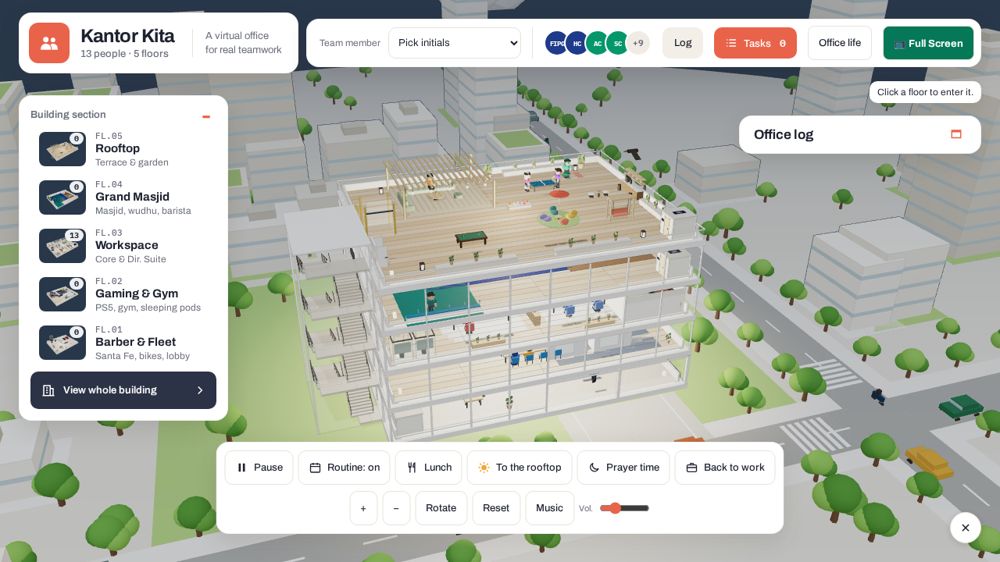
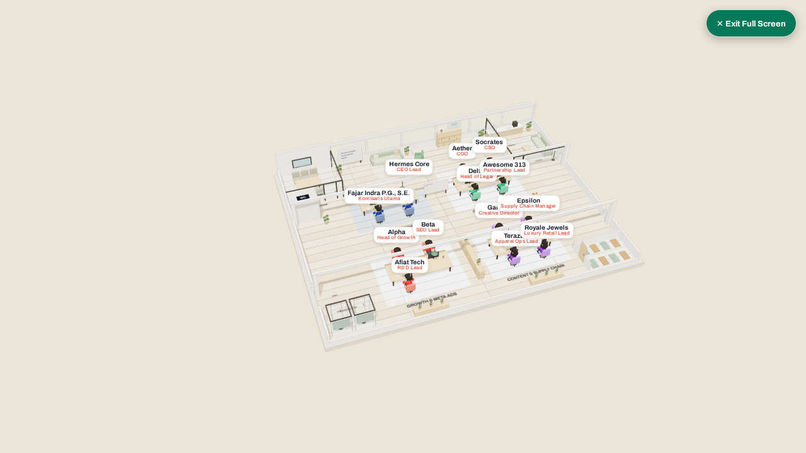
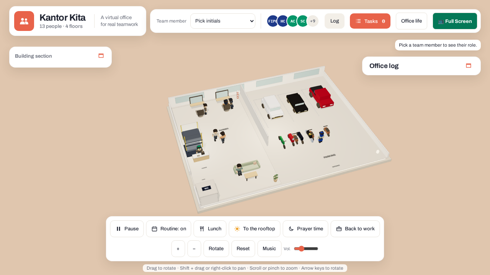

# 🏢 3D AI Virtual Office

[](https://opensource.org/licenses/MIT)
[](https://threejs.org/)
[](https://anthropic.com/)
[](#)

> **An interactive 3D isometric virtual office where autonomous AI agents (Claude, Hermes, LLMs) walk, collaborate, perform scheduled routines, and execute live tasks in a real-time WebGL space.**

---



## 🌟 Overview
Most multi-agent frameworks represent autonomous workers as boring console logs or raw text streams. **3D AI Virtual Office** transforms agentic workflows into a living, physical 3D workspace rendered entirely in client-side **Three.js**.

Agents have physical presence: they sit at desks to draft content, take coffee breaks in the pantry, participate in review meetings inside glass conference booths, walk across floors via animated staircases, and observe prayer times in the dedicated prayer room (*musholla*).

---

## 🏛️ Building Architecture (5-Tier Layout)

| Floor | Zone | Key Features |
| :--- | :--- | :--- |
| **04** | **Rooftop Lounge** | Pergola garden, coffee bar, communal wooden tables, billiard lounge, lantern lighting. |
| **03** | **Open Workfloor** | Autonomous desks (Leadership, Engineering, Marketing, CS), idea board, glass conference rooms, phone booths, musholla. |
| **02** | **Kitchen & Dining** | Full pantry, espresso machines, dining tables for simulated peer breaks. |
| **01** | **Reception & Parking**| Lobby check-in, parking bays, exterior glass elevator tower. |
| **Whole** | **City Isometric View** | Multi-floor glass cross-section, animated clouds, birds, surrounding city blocks. |

---

## 🚀 Key Features

### 1. Autonomous AI Agent Workers (Claude Integration)
- Connects directly to **Claude 3.5 / 5.5** via Anthropic API (`server/agents.js`).
- Agents automatically pick tasks from the queue: **Queued → In progress → Needs review**.
- Full support for **Dry-Run Mode** (zero API key required for testing simulation).

### 2. Multi-Perspective Camera System
- **Isometric Maket View:** Orbit, tilt, pan, and zoom with smooth inertia.
- **Whole Building Cross-Section:** View all 5 floors stacked with transparent glass facades.
- **First-Person & Follow Camera:** Walk alongside any agent in real-time as they navigate the building.

### 3. Procedural Lo-Fi Synthesizer (Zero-Token Audio)
- Built-in soothing ambient music generator running purely on the **Web Audio API** (72 BPM soft chords and bassline). No external MP3 files or streaming services required.

---

## 📦 Quick Start

### Option A: Static Demo (No Node.js Required)
Simply serve the `public/` folder using Python:
```bash
python3 -m http.server 4173 --directory public --bind 127.0.0.1
```
Open `http://localhost:4173` in your browser.

### Option B: Full AI Agent Task Server
1. Clone the repository:
   ```bash
   git clone https://github.com/diptapradipta21/3d-ai-virtual-office.git
   cd 3d-ai-virtual-office
   ```
2. Configure environment:
   ```bash
   cp .env.example .env
   # Add your ANTHROPIC_API_KEY (optional, runs in dry-run if omitted)
   ```
3. Start the server:
   ```bash
   npm start
   # Or: node server/server.js
   ```
4. Navigate to `http://localhost:3000`.

---

## 📸 Screenshots

| Open Workfloor (Level 3) | 5-Floor Isometric Cross-Section |
| :---: | :---: |
|  |  |

---

## 📄 License
This project is open-source under the [MIT License](LICENSE). Contributions, custom avatar designs, and framework integrations are welcome!
